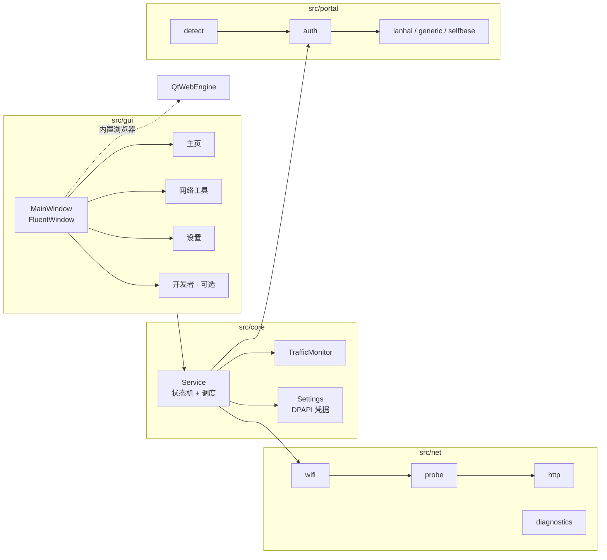

# CampusNet · 校园网助手

**一个专注「把校园网连上、把网速看清楚」的 Windows 桌面客户端。**

自动连接校园 WiFi、自动完成 Portal 认证、掉线自动重连，顺带把流量统计、网络诊断、账户与套餐查询都放进同一个 FluentUI 界面。


---

## ✨ 功能

| 模块 | 能力 |
| --- | --- |
| **自动连接** | 监听 SSID，命中白名单后自动连接 WiFi → 探测 Portal → 提交认证，全程无需点击 |
| **自动重试** | 认证失败按间隔重试；检测到掉线自动重连；可配置「在线数已满」时抢占最早设备 |
| **状态面板** | 连接状态、在线时长、本月上下行流量、套餐名称与到期时间，一眼可见 |
| **流量统计** | 读取网卡计数器，按分钟/小时/天聚合，支持曲线图、历史柱状图、CSV 导出、保留天数清理 |
| **网络诊断** | 网关 / 出口 IP / DNS / TCP 延迟 / 丢包 / 抖动 / 下载与上传测速，一键出报告 |
| **无线网络** | 扫描周边 SSID、信号强度、加密方式，手动连接与断开 |
| **账户与设备** | 登录自助系统查看在线设备、套餐余量、订单记录，支持远程下线指定设备 |
| **托盘常驻** | 托盘图标显示状态，右键快速连接/断开，关闭窗口可选最小化到托盘 |
| **开机自启** | 写入计划任务（而不是 Run 键），确保要求管理员权限的程序也能正常启动 |
| **主题** | 浅色 / 深色 / 跟随系统，Windows 11 下支持云母（Mica）材质 |
| **开发者模式** | 默认关闭；打开后出现「开发者」页，可逐个调用接口并查看原始返回，便于排查学校侧变更 |

所有耗时操作都在线程池里跑，界面不会卡住；认证、掉线、冲突等关键事件通过系统通知提醒，可一键静音。

## 🧱 架构



- `src/core/service.py` 是唯一的状态机：检查 → 连 WiFi → 认证 → 在线 → 掉线重试。
- `src/portal/*` 按「识别门户 → 选驱动 → 提交认证」拆分，新增学校只需加一个驱动。
- `src/net/http.py` 统一封装请求（优先 `requests`，缺失时回退 `urllib`），忽略自签证书、保留重定向信息。

## 🚀 快速开始

### 环境要求

- Windows 10 / 11（x64）
- Python 3.10+（推荐 3.12 / 3.14）
- 首次运行会请求管理员权限：连接 WiFi、读取网卡计数器和写计划任务都需要它

### 从源码运行

```powershell
git clone https://github.com/<your-name>/CampusNet.git
cd CampusNet

py -m venv .venv
.\.venv\Scripts\Activate.ps1
py -m pip install -r requirements.txt

py main.py
```

自检（不启动界面，逐项检查依赖与能力）：

```powershell
py main.py --selftest
```

### 打包成单文件 exe

```powershell
powershell -ExecutionPolicy Bypass -File build.ps1
# 产物：dist\CampusNet.exe
```

`build.ps1` 已内置 QtWebEngine、pyqtgraph、qfluentwidgets 等隐式依赖和资源目录；打包后 `dist\CampusNet.exe` 可直接分发，目标机器无需安装 Python。

## 🧭 使用指南

1. **首次启动** 打开「设置 → 账号」，填入校园网账号密码并保存（密码用 Windows DPAPI 加密，只在本机可解密）。
2. **主页** 显示当前状态；点「一键连接」可立即走一遍完整流程。
3. **网络工具** 分六个分区：无线网络、网络诊断、流量统计、账户与设备、运行日志。
4. **托盘** 双击图标唤起窗口；右键菜单可快速连接 / 断开 / 退出。
5. **开发者模式** 默认关闭，在「设置 → 界面与启动」里打开后，左侧导航底部会出现「开发者」页。

> 提示：程序只负责「连接 + 认证 + 观测」，不会修改系统网络配置，也不会代理任何流量。

## ⚙️ 配置项

配置保存在 `%APPDATA%\CampusNet\settings.json`，也可以在设置页里改。

| 配置 | 默认值 | 说明 |
| --- | --- | --- |
| `auto_connect` | `true` | 检测到白名单 SSID 时自动连接 |
| `auto_login` | `true` | 连上 WiFi 后自动提交认证 |
| `wifi_allow_list` | `NYKJ` 等 4 项 | 允许自动连接的 SSID；忽略大小写与 `-` `_` 分隔符，按包含匹配 |
| `driver` | `auto` | 认证驱动：`auto` / `lanhai` / `generic` |
| `retry_count` | `3` | 认证失败重试次数 |
| `retry_delay_ms` | `8000` | 重试间隔 |
| `auto_retry_on_drop` | `true` | 掉线后自动重试 |
| `auto_reconnect_on_logout` | `true` | 被强制下线后自动重连 |
| `kick_on_conflict` | `false` | 在线数已满时下线最早设备再登录 |
| `notify_on_drop` | `true` | 掉线时通知 |
| `show_notification` | `true` | 系统通知**总开关**（关掉后所有通知都不弹） |
| `traffic_interval_ms` | `5000` | 流量采样间隔 |
| `traffic_retention_days` | `120` | 历史记录保留天数 |
| `quota_auto` | `true` | 从自助系统自动读取本月额度 |
| `monthly_quota_gb` | `0` | 手动额度；`0` 表示不统计配额 |
| `theme` | `auto` | `auto` / `light` / `dark` |
| `mica_effect` | `true` | 云母材质（Win10 无效，切换即时生效） |
| `close_to_tray` | `true` | 关闭窗口时最小化到托盘 |
| `auto_launch` | `false` | 开机自启（写计划任务） |
| `start_minimized` | `false` | 启动后直接缩到托盘 |
| `developer_mode` | `false` | 显示「开发者」页 |

## 📁 目录结构

```
CampusNet/
├── main.py                  # 入口：--selftest / --connect-only / 正常启动
├── build.ps1                # PyInstaller 打包脚本
├── requirements.txt
├── resources/               # 图标、托盘图、WiFi 与流量统计 PowerShell 脚本
└── src/
    ├── core/                # service（状态机）、settings（DPAPI）、traffic、winutil…
    ├── net/                 # wifi、probe、http、diagnostics
    ├── portal/              # detect、auth、lanhai、generic、selfbase、selfservice
    └── gui/                 # app、pages、charts、widgets、theme、browser…
```

## ❓ 常见问题

**为什么 exe 有 130 MB？**
QtWebEngine（Chromium）本身就占大头；单文件模式还会把运行库一起塞进去。想瘦身可以改用 `--onedir` 或去掉内置浏览器。

**启动时报 `Could not create temporary directory!`**
单文件模式依赖 `%TEMP%` 解压。若你在 MSYS2 / Git Bash 里运行，`TEMP` 可能被设成 `/tmp` 这类 POSIX 路径，改回 `C:\Users\<你>\AppData\Local\Temp` 即可。

**点了关闭，程序还在运行？**
默认「关闭时最小化到托盘」，可从托盘右键退出，或在设置里关掉这一项。

**测速一直转圈？**
测速源可能被校园网关拦截。当前版本对每次测速都有总时长上限，超时会自行结束并提示；也可以在诊断页只测下载。

**通知关不掉？**
「系统通知」是总开关，关掉后认证、掉线、冲突提示都不会弹；`notify_on_drop` 只是掉线通知的细分开关。

**需要管理员权限吗？**
连接/断开 WiFi、读取网卡计数器、写计划任务都需要，程序启动时会自动请求提权。

**学校门户不一样怎么办？**
设置里可填「自定义 Portal 地址」，并把驱动切成「通用 Portal（表单提交）」；若仍不适配，`src/portal/` 下新增一个驱动即可。

## 🔐 数据与隐私

- 账号密码用 Windows **DPAPI**（`CryptProtectData`）加密，密文与当前 Windows 用户绑定，拷走也无法解密。
- 所有运行数据（配置、流量历史、日志、内置浏览器缓存）都在 `%APPDATA%\CampusNet`，不会上传到任何第三方。
- 程序只访问校园网 Portal 与自助系统；测速会连接公共测速源（可关闭）。

## 🛠 开发

```powershell
py -m compileall -q src main.py   # 语法检查
py main.py --selftest             # 能力自检
py -m pip install pyinstaller     # 打包依赖
```

代码风格：PEP 8、四空格缩进、类型注解齐全、模块级 `from __future__ import annotations`；界面层不写阻塞调用，统一走 `run_async`。

## 📄 许可证

[MIT](LICENSE)

## ⚠️ 免责声明

本项目仅供学习与个人使用，与任何学校、运营商或设备厂商无关。请遵守所在学校的网络使用规定；使用本工具产生的任何后果由使用者自行承担。
